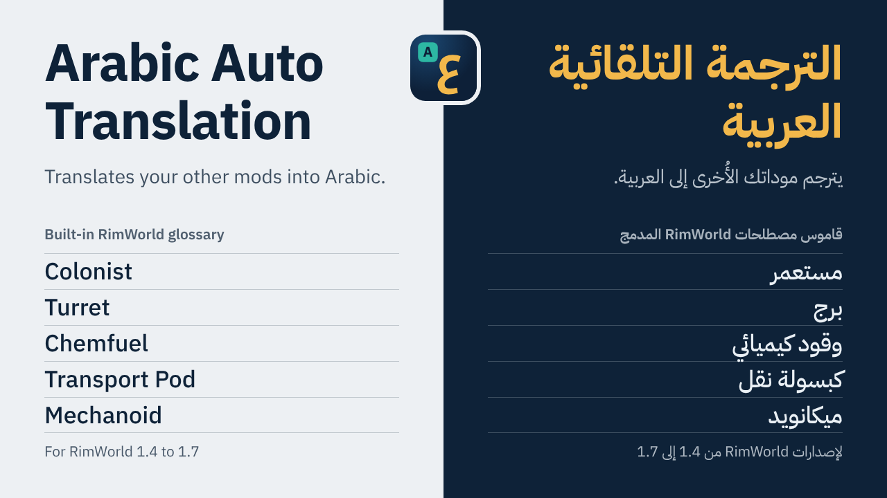

  🇮🇶 <a href="#arabic">العربية</a> |  🇬🇧 <a href="#english">English</a>

  
  
  
  

  

# 🇮🇶 مود Arabic Auto Translation | ترجمة المودات إلى العربية أثناء اللعب

يترجم مود Arabic Auto Translation نصوص المودات الأخرى في لعبة RimWorld إلى اللغة العربية أثناء اللعب. فالمودات التي تأتي بالإنجليزية فقط تصبح مقروءة بالعربية، بحروف متصلة واتجاه صحيح من اليمين إلى اليسار، وتبقى مصطلحات RimWorld موحدة في كل مكان.

---

## ماذا يفعل المود؟

- **ترجمة المودات الأخرى تلقائيا:** أسماء العناصر وأوصافها والأزرار وبقية النصوص في المودات التي تلعب بها.
- **العربية فقط:** يترجم دائما إلى العربية، مهما كانت لغة المود الأصلية.
- **مجاني:** خدمة Yandex هي الافتراضية ولا تحتاج إلى حساب أو مفتاح. وإذا كانت محجوبة في شبكتك يتحول المود إلى Google تلقائيا. ويمكنك اختيار خدمات أخرى (DeepL وChatGPT وClaude وGemini وغيرها) من الإعدادات إذا كان لديك مفتاح.
- **مصطلحات موحدة:** قاموس مدمج يضم نحو 1,060 مصطلحا من RimWorld يجعل كل مصطلح يُترجم بالطريقة نفسها في كل المودات.
- **ترجمة لمرة واحدة:** تُحفظ الترجمات لكل مود على حدة، فلا يُترجم النص إلا مرة واحدة، ويصبح التشغيل التالي أسرع.
- **عرض عربي سليم:** تتصل الحروف ويسير النص من اليمين إلى اليسار، وتبقى الكلمات الإنجليزية والأرقام والرموز مثل `{0}` سليمة داخل الجملة العربية.
- **أنت المتحكم:** اختر المودات التي تُترجم، وصحّح أي ترجمة بنفسك من محرر الترجمة.

---

## المتطلبات

- RimWorld 1.4 أو 1.5 أو 1.6 أو 1.7 (يختار المود الملفات المناسبة لإصدارك تلقائيا).
- مود Harmony (مطلوب في RimWorld 1.7 فقط).
- اتصال بالإنترنت: تُرسل النصوص إلى خدمة الترجمة.

---

## طريقة التثبيت

1. حمّل أحدث إصدار من صفحة Releases وفك ضغطه.
2. انسخ مجلد `ArabicAutoTranslation` إلى مجلد `Mods` داخل مجلد RimWorld.
3. شغّل اللعبة وفعّل مود **Arabic Auto Translation** من قائمة المودات (مع Harmony في RimWorld 1.7).
4. اختر اللغة العربية من *Options ← Language* ثم أعد تشغيل اللعبة.

التشغيل الأول يستغرق وقتا أطول قليلا، لأن كل نص يجب أن يُترجم مرة واحدة. وبعد ذلك تُستخدم الترجمات المحفوظة فورا.

### المسارات الافتراضية

Steam:
`C:\Program Files (x86)\Steam\steamapps\common\RimWorld\Mods`

GOG:
`C:\GOG Games\RimWorld\Mods`

---

## الإعدادات

من *Options ← Mod settings ← Arabic Auto Translation*. تعمل الإعدادات الافتراضية جيدا لمعظم اللاعبين، ولا تحتاج إلى تغيير شيء إلا إذا أردت.

| التبويب | ما يمكنك تغييره |
|---|---|
| عام | تشغيل الترجمة أو إيقافها، واختيار ترجمة المودات المضافة حديثا تلقائيا أو لا، وتفعيل ترجمة اللعبة الأساسية والإضافات الرسمية (متوقف افتراضيا) |
| المترجم | اختيار خدمة الترجمة. الافتراضية Yandex مع تحويل تلقائي إلى Google |
| التعديلات المستهدفة | اختيار المودات التي تُترجم |
| محرر الترجمة | تصحيح أي نص مترجم، أو استبدال كلمة في نصوص كثيرة دفعة واحدة |
| متقدم | حذف الترجمات المحفوظة إذا لم تُترجم بعض النصوص |
| العربية | اختيار طريقة عرض النص العربي |

**وضع النص (تبويب العربية):** الوضع الافتراضي *ربط الحروف وإعادة الترتيب* مناسب للعبة العادية، وهو الوضع الذي يعمل مع مود ArabicSupport دون أي تعارض لأنه يتوقع نصا مربوط الحروف ومعاد الترتيب. أما إذا كنت تستخدم مودا يربط الحروف ويرتبها بنفسه أثناء الرسم، فاختر *نص منطقي عادي* حتى لا تُعالج النصوص مرتين.

**اللعبة الأساسية والإضافات الرسمية:** لا يفحصها المود ولا يترجمها ولا يغيرها إلا إذا فعّلت الخيار *ترجمة اللعبة الأساسية RimWorld والإضافات الرسمية أيضا* من تبويب عام (ويسري بعد إعادة تشغيل اللعبة). فهي تأتي عادة من ترجمة عربية جاهزة مثل ArabicSupport، ويعمل هذا المود على المودات الأخرى فقط.

---

## نصائح

- **نص ما زال بالإنجليزية:** تفشل خدمة الترجمة أحيانا في نص ما، فيُبقي المود النص الأصلي. استخدم أزرار إعادة التعيين في تبويب متقدم ثم أعد تشغيل اللعبة للمحاولة من جديد. ويمكنك أيضا تصحيح النص بنفسك من محرر الترجمة.
- **Yandex لا يعمل عندك:** يتحول المود إلى Google تلقائيا. وإذا كانت الخدمتان محجوبتين في بلدك فاستخدم VPN أو اختر مترجما آخر من تبويب المترجم.
- **تظهر الحروف مربعات فارغة:** خط اللعبة لا يحتوي على الحروف العربية. استخدم مودا يضيف خطا عربيا، مثل ArabicSupport.
- **لا تفعّله مع مود Auto Translation الأصلي.**
- **الخصوصية:** تُرسل النصوص التي تُترجم إلى خدمة الترجمة التي اخترتها.

---

## الإبلاغ عن المشكلات

إذا واجهت مشكلة، افتح بلاغا (Issue) مع إرفاق: إصدار اللعبة، ولقطة شاشة، وقائمة المودات التي تستخدمها، وسجل اللعبة.

---

## الشكر والترخيص

- المؤلف: Mushussu Babylon
- مبني على مود **Auto Translation** من SeoHyeon. وكل ما يعتمد عليه مذكور في [THIRD_PARTY_NOTICES.md](THIRD_PARTY_NOTICES.md).
- شكر خاص: لمكتبة Harmony ولمجتمع مودرات RimWorld.
- الترخيص: [رخصة GNU العامة الإصدار 3](LICENSE). وهذا العمل غير تابع لشركة Ludeon Studios.

---

أُهدي هذا العمل إلى جميع لاعبي RimWorld الناطقين بالعربية. استمتعوا باللعبة!

  <a href="#languages">⬆ العودة إلى اختيار اللغة</a>

---

# 🇬🇧 Arabic Auto Translation: Arabic translation for your RimWorld mods

Arabic Auto Translation translates the text of your other RimWorld mods into Arabic while you play. Mods that only come in English become readable in Arabic, with joined letters and right-to-left order, and RimWorld terms stay the same everywhere.

---

## What does it do?

- **Translates your other mods automatically:** item names, descriptions, buttons and other texts of the mods you play with.
- **Arabic only:** it always translates into Arabic, whatever language the mod was written in.
- **Free to use:** Yandex is the default and needs no account or key. If Yandex is blocked on your network, the mod switches to Google by itself. Other services (DeepL, ChatGPT, Claude, Gemini and more) can be chosen in the settings if you have a key.
- **Same terms everywhere:** a built-in glossary of about 1,060 RimWorld terms makes sure each term is translated the same way in every mod.
- **Translated once:** translations are saved for each mod, so every text is translated only once and the next start is quick.
- **Correct Arabic display:** letters are joined and text runs right-to-left. English words, numbers and codes such as `{0}` stay intact inside Arabic sentences.
- **You stay in control:** choose which mods get translated, and fix any translation yourself in the Translation Editor.

---

## Requirements

- RimWorld 1.4, 1.5, 1.6 or 1.7 (the mod picks the right files for your version automatically).
- The Harmony mod (required on RimWorld 1.7 only).
- An internet connection: the texts are sent to the translation service.

---

## Installation

1. Download the latest release from the Releases page and extract it.
2. Copy the `ArabicAutoTranslation` folder into the `Mods` folder inside your RimWorld folder.
3. Start the game and enable **Arabic Auto Translation** in the Mods menu (with Harmony on RimWorld 1.7).
4. Select Arabic in *Options → Language* and restart the game.

The first start takes a little longer, because every text has to be translated once. After that, the saved translations are used right away.

### Default paths

Steam:
`C:\Program Files (x86)\Steam\steamapps\common\RimWorld\Mods`

GOG:
`C:\GOG Games\RimWorld\Mods`

---

## Settings

Open *Options → Mod settings → Arabic Auto Translation*. The defaults work well for most players, so you only need to change something if you want to.

| Tab | What you can change |
|---|---|
| General | Turn translation on or off, choose whether newly added mods are translated automatically, and turn on translation of RimWorld Core and the official DLCs (off by default) |
| Translator | Pick the translation service. Yandex is the default, with automatic Google fallback |
| Target Mods | Choose which mods get translated |
| Translation Editor | Fix any translated text, or replace a word in many texts at once |
| Advanced | Delete the saved translations if some texts did not translate |
| Arabic | Choose how Arabic text is displayed |

**Text mode (Arabic tab):** the default, *Shaped and reordered*, is right for the normal game. It is also the mode that works with ArabicSupport, which expects text that is already shaped and reordered, so the two mods do not conflict. Only if you use a mod that shapes and reorders Arabic itself while text is drawn, choose *Plain logical text* so the text is not processed twice.

**RimWorld Core and the official DLCs:** this mod does not scan, translate or change them unless you turn on *Also translate RimWorld Core and the official DLCs* in the General tab (applied after a game restart). They normally come from a ready Arabic translation such as ArabicSupport; this mod works on other mods only.

---

## Tips

- **A text is still in English:** the translation service sometimes fails on a text, and the mod then keeps the original. Use the reset buttons on the Advanced tab and restart the game to try again. You can also fix the text yourself in the Translation Editor.
- **Yandex does not work for you:** the mod switches to Google automatically. If both are blocked in your country, use a VPN or pick another translator on the Translator tab.
- **Letters appear as empty boxes:** the game font has no Arabic letters. Use a mod that adds an Arabic font, such as ArabicSupport.
- **Do not enable it together with the original Auto Translation mod.**
- **Privacy:** the texts being translated are sent to the translation service you chose.

---

## Bug Reports

If you run into a problem, open an Issue and include: your game version, a screenshot, your mod list and the game log.

---

## Credits and License

- Author: Mushussu Babylon
- Built on **Auto Translation** by SeoHyeon. Everything it uses is credited in [THIRD_PARTY_NOTICES.md](THIRD_PARTY_NOTICES.md).
- Special thanks: to the Harmony library and the RimWorld modding community.
- License: [GNU General Public License v3](LICENSE). Not affiliated with Ludeon Studios.

---

Made for all Arabic-speaking RimWorld players. Enjoy the game!

  <a href="#languages">⬆ Back to language selection</a>

